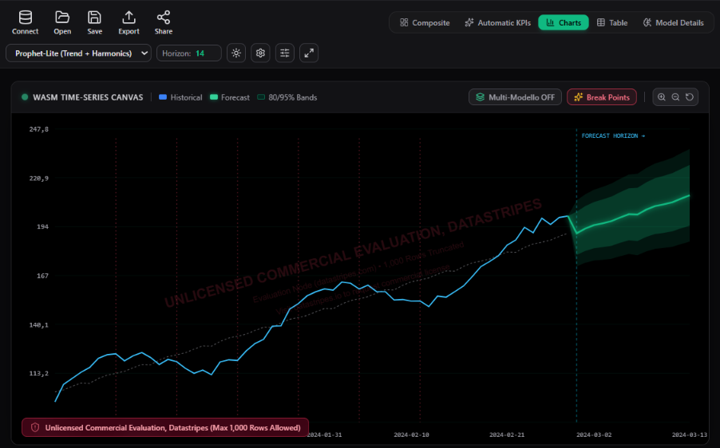
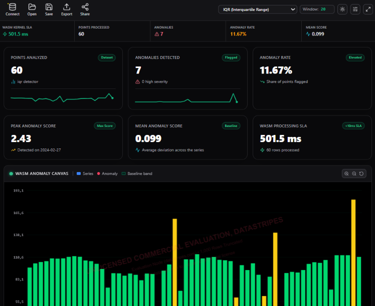

<p align="center">
  <a href="https://datastripes.com/?utm_source=github&utm_medium=readme&utm_campaign=widgets">
    
  </a>
</p>

<p align="center">
  <a href="https://www.npmjs.com/package/@datastripes/forecast"></a>
  <a href="https://www.npmjs.com/package/@datastripes/anomaly"></a>
  <a href="https://www.npmjs.com/package/@datastripes/dashboard"></a>
  <br>
  
  
  
  
  
  
  
</p>

<p align="center">
  <a href="https://datastripes.com/?utm_source=github&utm_medium=readme&utm_campaign=widgets"><b>Website</b></a> ·
  <a href="https://datastripes.com/forecast-widget/"><b>Forecast</b></a> ·
  <a href="https://datastripes.com/anomaly-widget/"><b>Anomaly</b></a> ·
  <a href="https://datastripes.com/dashboard-widget/"><b>Dashboard</b></a> ·
  <a href="https://www.npmjs.com/org/datastripes"><b>npm</b></a>
</p>

---

Three npm packages for the data features users keep asking for: a forecast of what comes next, a warning when a metric looks wrong, and a dashboard they can rearrange. Each one is a single package with a framework-free core and drop-in components for React, Vue, Angular and plain HTML. The forecasting and anomaly engines are compiled to WebAssembly and run in the browser, so the rows you pass in are not sent to a server to be analysed.

<table>
  <tr>
    <td width="33%" valign="top">
      <a href="#forecast"></a>
      <h3><a href="#forecast">Forecast</a></h3>
      Time series forecasting with nine algorithms and a confidence band.
      <br><br><code>npm i @datastripes/forecast</code>
    </td>
    <td width="33%" valign="top">
      <a href="#anomaly-detection"></a>
      <h3><a href="#anomaly-detection">Anomaly detection</a></h3>
      Six detection methods for time series, plus scatter detection for pairs of metrics.
      <br><br><code>npm i @datastripes/anomaly</code>
    </td>
    <td width="33%" valign="top">
      <a href="#dashboard-builder"></a>
      <h3><a href="#dashboard-builder">Dashboard builder</a></h3>
      An editable grid dashboard driven by a JSON config you can store.
      <br><br><code>npm i @datastripes/dashboard</code>
    </td>
  </tr>
</table>

## Forecast

<a href="https://datastripes.com/forecast-widget/"></a>

`@datastripes/forecast` turns a history of dates and values into a projection with a confidence band, computed by a WebAssembly engine in the browser.

- Nine algorithms: `ols`, `polynomial`, `ridge`, `lasso`, `holt_winters_add`, `holt_winters_mul`, `arima`, `prophet_lite` and `ensemble`
- Confidence level of 80, 90 or 95 percent
- Views for a composite layout, a chart, a table, a KPI card or model details
- Accepts records, CSV text or a JSON array, with column auto-discovery

```ts
import { executeForecast } from '@datastripes/forecast';

const result = await executeForecast({
  data: [{ date: '2024-01-01', value: 120 }, /* ... */],
  algorithm: 'prophet_lite',
  horizon: 30,
});
```

```tsx
import { DatastripesForecast } from '@datastripes/forecast/react';

<DatastripesForecast data={rows} algorithm="holt_winters_mul" horizon={12} confidenceLevel={90} />
```

<a href="https://datastripes.com/forecast-widget/">Live demo</a> ·
<a href="https://datastripes.com/forecast-widget/docs/">Docs</a> ·
<a href="https://datastripes.com/add-forecasting-to-your-web-app/">Guide: add forecasting to your web app</a> ·
<a href="https://www.npmjs.com/package/@datastripes/forecast">npm</a>

<br clear="right">

## Anomaly detection

<a href="https://datastripes.com/anomaly-widget/"></a>

`@datastripes/anomaly` flags the points that break the pattern and draws them on a chart, with a shaded band for the expected range and dots colored by severity.

- Six methods: `zscore`, `rolling_zscore`, `iqr`, `mad`, `stl_residual` and `ensemble`, a majority vote of the other five
- Line or bar rendering, the latter for sparse daily or weekly data
- Scatter detection for two metrics without a time axis, using Mahalanobis distance
- A details panel that shows what each method finds and how much they agree

```ts
import { executeAnomalyDetection } from '@datastripes/anomaly';

const result = await executeAnomalyDetection({
  data: [{ date: '2024-01-01', value: 120 }, /* ... */],
  algorithm: 'ensemble',
});
```

```tsx
import { DatastripesAnomaly } from '@datastripes/anomaly/react';

<DatastripesAnomaly data={rows} customOptions={{ chart: { renderMode: 'bar' } }} />
```

<a href="https://datastripes.com/anomaly-widget/">Live demo</a> ·
<a href="https://datastripes.com/anomaly-widget/docs/">Docs</a> ·
<a href="https://datastripes.com/add-anomaly-detection-to-your-web-app/">Guide: add anomaly detection to your web app</a> ·
<a href="https://www.npmjs.com/package/@datastripes/anomaly">npm</a>

<br clear="right">

## Dashboard builder

<a href="https://datastripes.com/dashboard-widget/"></a>

`@datastripes/dashboard` renders a dashboard from an array of rows and a JSON config. In edit mode your users add widgets, drag and resize them, and save the result.

- A widget wizard with 25 chart types, rendered with ECharts
- Settings for number formatting, calculated fields and column labels
- Global filters, drill-down and cross-filter events
- Light and dark themes, PDF export and a period navigator
- The config is plain JSON, so you can store it per user and load it back

```tsx
import { DatastripesDashboard } from '@datastripes/dashboard/react';

<DatastripesDashboard
  data={rows}
  config={config}
  mode="edit"
  apiKey={import.meta.env.VITE_DATASTRIPES_KEY}
  onSave={(saved) => persistToBackend(saved)}
/>
```

```html
<script src="https://unpkg.com/@datastripes/dashboard/dist/elements/index.global.js"></script>
<datastripes-dashboard id="dash" mode="edit"></datastripes-dashboard>
```

<a href="https://datastripes.com/dashboard-widget/">Live demo</a> ·
<a href="https://datastripes.com/dashboard-widget/docs/">Docs</a> ·
<a href="https://datastripes.com/embed-dashboard-builder-in-your-web-app/">Guide: embed a dashboard builder in your app</a> ·
<a href="https://www.npmjs.com/package/@datastripes/dashboard">npm</a>

<br clear="right">

## Framework support

Every package uses the same layout. The root import is the framework-free core, and each framework has its own subpath. React, Vue and Angular are optional peer dependencies, so installing a package never pulls one in.

| Import | Forecast | Anomaly | Dashboard |
|---|:-:|:-:|:-:|
| Core, no UI | `@datastripes/forecast` | `@datastripes/anomaly` | `@datastripes/dashboard` |
| React | `/react` | `/react` | `/react` (React 19) |
| Vue 3 | `/vue` | `/vue` | `/vue` (Vue 3.4+) |
| Angular | `/angular` | `/angular` | `/angular` (Angular 18 or 19) |
| Custom Element | `<datastripes-forecast-studio>` | `<datastripes-anomaly-studio>` | `<datastripes-dashboard>` |

## Licensing

The packages are published on npm under Apache-2.0. Without a license key every widget runs in a trial tier that keeps the first 1,000 rows, disables export and shows a watermark. A key from [datastripes.com](https://datastripes.com/forecast-widget/#pricing) removes those limits. The license check sends your key and your app's domain to the licensing server, never your data.

## Links

| | |
|---|---|
| Website | [datastripes.com](https://datastripes.com/?utm_source=github&utm_medium=readme&utm_campaign=widgets) |
| Forecast | [Demo](https://datastripes.com/forecast-widget/) · [Docs](https://datastripes.com/forecast-widget/docs/) · [npm](https://www.npmjs.com/package/@datastripes/forecast) |
| Anomaly | [Demo](https://datastripes.com/anomaly-widget/) · [Docs](https://datastripes.com/anomaly-widget/docs/) · [npm](https://www.npmjs.com/package/@datastripes/anomaly) |
| Dashboard | [Demo](https://datastripes.com/dashboard-widget/) · [Docs](https://datastripes.com/dashboard-widget/docs/) · [npm](https://www.npmjs.com/package/@datastripes/dashboard) |

<p align="center">
  <sub>Built by <a href="https://datastripes.com/">Datastripes</a></sub>
</p>
